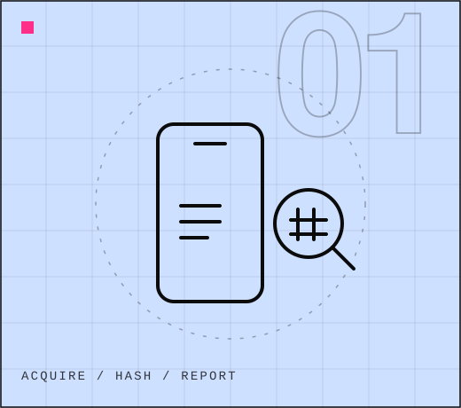
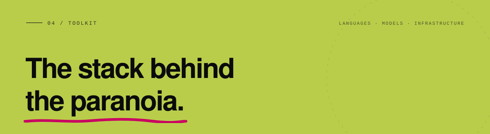
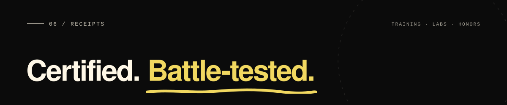

  <a href="#user-content-about"><b>ABOUT</b></a> &nbsp;·&nbsp;
  <a href="#user-content-experience"><b>EXPERIENCE</b></a> &nbsp;·&nbsp;
  <a href="#user-content-work"><b>WORK</b></a> &nbsp;·&nbsp;
  <a href="#user-content-toolkit"><b>TOOLKIT</b></a> &nbsp;·&nbsp;
  <a href="#user-content-contact"><b>CONTACT</b></a> &nbsp;·&nbsp;
  <a href="https://atul2512anand.github.io/"><b>PORTFOLIO ↗</b></a>

WORKED &amp; TRAINED WITH

<b>EmergeSmart Health</b> &nbsp;·&nbsp; <b>IIT (BHU)</b> &nbsp;·&nbsp; <b>Vodafone Intelligent Solutions</b> &nbsp;·&nbsp; <b>CoE-CS, NFSU</b>

---

I build secure, intelligent systems — from blockchain supply-chain traceability to predictive-maintenance agents. B.Tech–M.Tech Cybersecurity student at NFSU with hands-on experience across AI/ML, OSINT, cloud and OT security.

<table>
<tr>
<td width="58%" valign="top">
<h3>At a glance</h3>

<strong>8.80 / 10</strong> — GPA at NFSU 
<strong>04</strong> — internships &amp; training 
<strong>03</strong> — featured builds

<strong>Currently building</strong> AI video pipelines, autonomous agents and DFIR tooling. 
<strong>Open to</strong> security engineering internships and AI × security collaborations.

</td>
<td width="42%" valign="middle"></td>
</tr>
</table>

| # | ROLE | COMPANY | PERIOD |
|:--|:--|:--|--:|
| 01 | **Cybersecurity & Tech Analyst Intern** ZOHO CRM workflow · 50+ OSINT data points · HTTP-flood resilience testing | EmergeSmart Health (UAE) | JUL 2025 — FEB 2026 |
| 02 | **Research Intern** Under Dr. Priya Ranjan Muduli · ML/DL on 4 datasets at 85–95% accuracy | IIT (BHU) | MAY — JUL 2025 |
| 03 | **Data Analytics Intern** 9,994 retail entries · 5k+ health records · attrition model at 78% accuracy | Vodafone Intelligent Solutions | OCT — NOV 2024 |
| 04 | **CoE-CS OT/IT Security Trainee** PLCs, SCADA · ISO 27001 incident-response labs · SOC workflows · Top Performer | CoE-CS, NFSU | JUL 2025 |

<table>
<tr>
<td width="270" valign="middle"></td>
<td valign="top">

BUILD 01 / ANDROID FORENSICS

<h3><a href="https://github.com/Atul2512anand/NFSU-DFIR">NFSU DFIR</a></h3>

Logical Android acquisition with chain-of-custody built in: adb-shell pulls apps, calls, SMS, Chrome history and media, SHA-256 manifests verify every artefact, and a Flask dashboard streams the run before writing JSON + HTML forensic reports. EXIF GPS and SQLite freelist analysis surface location and deleted-record leads. 17/17 tests passing.

<code>Python</code> <code>adb-shell</code> <code>Flask</code> <code>SQLite</code> <code>SHA-256</code>

<a href="https://github.com/Atul2512anand/NFSU-DFIR"><strong>View on GitHub ↗</strong></a>

</td>
</tr>
<tr>
<td width="270" valign="middle"></td>
<td valign="top">

BUILD 02 / REMOTE TRIAGE

<h3><a href="https://github.com/Atul2512anand/android-security-triage">Android Security Triage</a></h3>

A consented, click-to-run Windows toolkit that checks a remote phone for spyware, stalkerware and backdoor indicators. It connects over Tailscale + ADB without installing anything on the phone, orchestrates MVT and APKiD (plus optional MobSF), hashes pulled APKs and writes a timestamped case file — with a redacted real-device case study.

<code>PowerShell</code> <code>ADB</code> <code>Tailscale</code> <code>MVT</code> <code>APKiD</code>

<a href="https://github.com/Atul2512anand/android-security-triage"><strong>View on GitHub ↗</strong></a>

</td>
</tr>
<tr>
<td width="270" valign="middle"></td>
<td valign="top">

BUILD 03 / MOTION PIPELINES

<h3><a href="https://github.com/Atul2512anand/video-kit">Video Kit</a></h3>

Two battle-tested pipelines that turn PDFs, sites and posts into finished motion video: a 23-second beat-synced UI morph loop and a 20-second cinematic security explainer. Playwright renders subframes, numpy blends motion blur, FFmpeg encodes, and sound hits are cut on measured peaks.

<code>Playwright</code> <code>GSAP</code> <code>FFmpeg</code> <code>HyperFrames</code>

<a href="https://github.com/Atul2512anand/video-kit"><strong>View on GitHub ↗</strong></a>

</td>
</tr>
</table>

 

**ALSO SHIPPED**

| PROJECT | WHAT IT DOES |
|:--|:--|
| [AgriChain](https://github.com/Atul2512anand/Agrichain) | Public blockchain traceability from farmer to distributor to retailer — role-based smart contracts on Ethereum Sepolia, deployed on Vercel. |
| [Autonomous Predictive Bike Maintenance](https://github.com/Atul2512anand/Autonomous-predictive-maintenance) | XGBoost flags failures 200–500 km early; LangChain + DeepSeek schedule service, find a mechanic and talk the rider through it. |
| [Face Recognition Attendance](https://github.com/Atul2512anand/Face-Recognition-Attendance-System) | Real-time OpenCV + Flask attendance with confidence scores, admin training panel and CSV export, deployed 24/7 on an Azure VM. |
| [LinkedIn Auto Publisher](https://github.com/Atul2512anand/linkedin-auto-publisher-) | Event-driven publisher: scans 15+ tech sources, scores stories, writes in my voice, posts through the official API. |
| [BuildForge](https://github.com/Atul2512anand/Buildforge) | Community-led talent platform: scoped-project marketplace, mentorship and verified proof-of-work passports. |
| [Wellfound Agent](https://github.com/Atul2512anand/wellfound-agent) | Local job agent that scrapes fresh roles, scores them against my resume with Ollama, and auto-applies with safety caps. |

<a href="https://github.com/Atul2512anand?tab=repositories">ALL REPOS ↗</a>

| LANGUAGES | FRAMEWORKS & DATA | AI / ML | SECURITY · BLOCKCHAIN · CLOUD |
|:--|:--|:--|:--|
| Python · Java · C/C++ · SQL · JavaScript · HTML/CSS | Flask · FastAPI · React · OpenCV · Pandas · NumPy · Matplotlib | Scikit-learn · XGBoost · KNN · SVM · Random Forests · LangChain · DeepSeek | Solidity · Ethereum · Ethers.js · Azure · Docker · Nginx · Git |

**FOCUS** &nbsp; `AI/ML` `Cybersecurity` `Blockchain` `Cloud` `OT/SCADA` `Data Analytics`

| GRADUATION | INTERMEDIATE / +2 | MATRICULATION |
|:--|:--|:--|
| **8.80 / 10** B.Tech–M.Tech, CS (Cybersecurity) National Forensic Sciences University, Dharwad 2023 — PRESENT | **92%** CBSE (XII) Central Board of Secondary Education 2022 | **98%** CBSE (X) Central Board of Secondary Education 2020 |

**RELEVANT COURSEWORK** &nbsp; `Cryptography & Network Security` `Digital Forensics` `OT/IT & SCADA Security` `AI for Cybersecurity` `Blockchain Technology` `Incident Response` `SOC Operations` `Cloud Computing`

<table width="100%">
<tr>
<th align="left" width="5%">#</th>
<th align="left" width="55%">TRAINING</th>
<th align="left" width="25%">ISSUER</th>
<th align="right" width="15%">DATE</th>
</tr>
<tr>
<td>01</td>
<td><strong>CoE-CS OT/IT Security Training</strong> PLCs, SCADA, SOC workflows and ISO 27001 incident-response labs</td>
<td>NFSU</td>
<td align="right">JUL 2025</td>
</tr>
<tr>
<td>02</td>
<td><strong>Zoho CRM &amp; WordPress Automation</strong> ZOHO CRM workflow and WordPress Webzine for health-tech outreach</td>
<td>EmergeSmart Health</td>
<td align="right">2025–26</td>
</tr>
<tr>
<td>03</td>
<td><strong>Quantum ML Literature Review</strong> Reviewed 3 papers bridging classical and quantum methods</td>
<td>IIT (BHU)</td>
<td align="right">MAY–JUL 2025</td>
</tr>
</table>

**ALSO ON THE RECORD**
- **Top Performer** — CoE-CS OT/IT Security hands-on assessment (PLCs, SCADA, SOC).
- **3 further shipped builds** across blockchain, AI and computer vision: AgriChain, predictive maintenance, attendance.
- **8.80/10 GPA** at NFSU · 92% CBSE XII · 98% CBSE X.

<table>
<tr>
<td width="50%" valign="top">
<strong>EMAIL</strong> 
<a href="mailto:atul.btmtcs10232807@nfsu.ac.in">atul.btmtcs10232807@nfsu.ac.in</a>  
<strong>PHONE</strong> 
+91 80024 24420  
<strong>BASED</strong> 
Dharwad, Karnataka, India
</td>
<td width="50%" valign="top">
<strong>RESUME</strong> 
<a href="https://atul2512anand.github.io/resume.pdf">Download PDF ↗</a>  
<strong>ELSEWHERE</strong> 
<a href="https://github.com/Atul2512anand">GitHub</a> · <a href="https://www.linkedin.com/in/atul-anand-53007a215/">LinkedIn</a> · <a href="https://x.com/atul_sci">X</a> · <a href="https://www.instagram.com/atul25anand/">Instagram</a> · <a href="https://leetcode.com/u/atul2512anand/">LeetCode</a>
</td>
</tr>
</table>

  
  

---

© 2026 Atul Anand · Dharwad, India · Portfolio-synced Nov 2026

